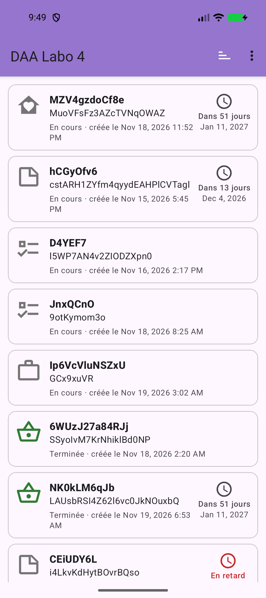
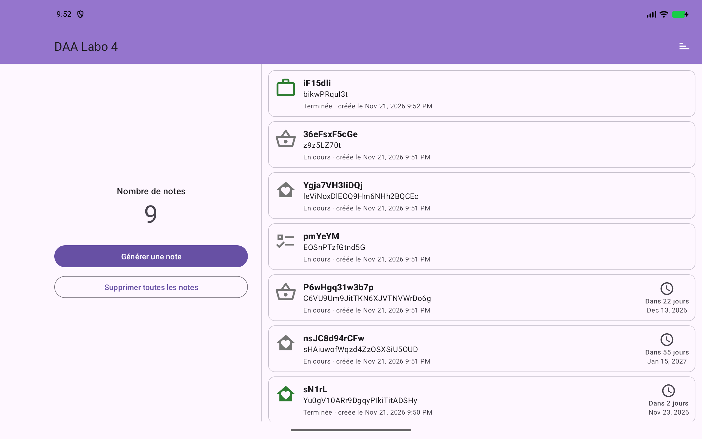
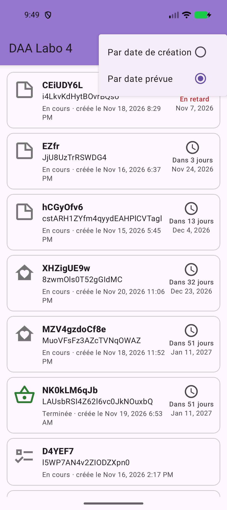
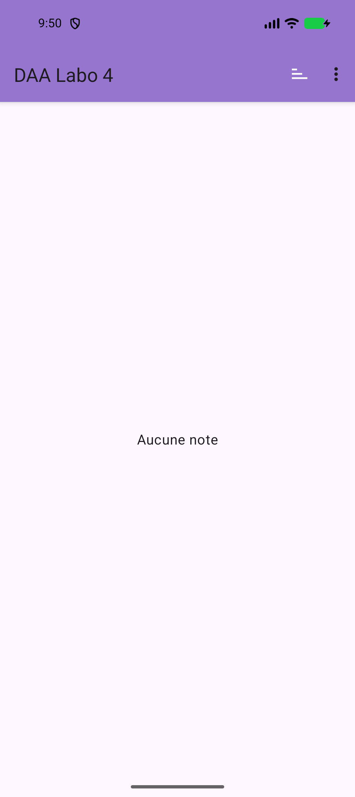
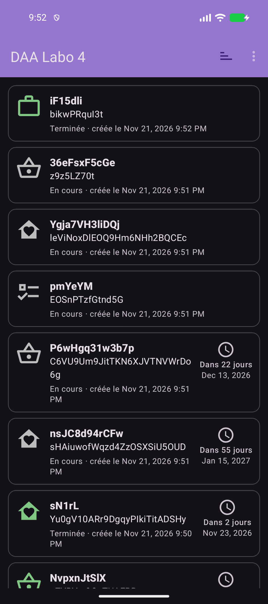
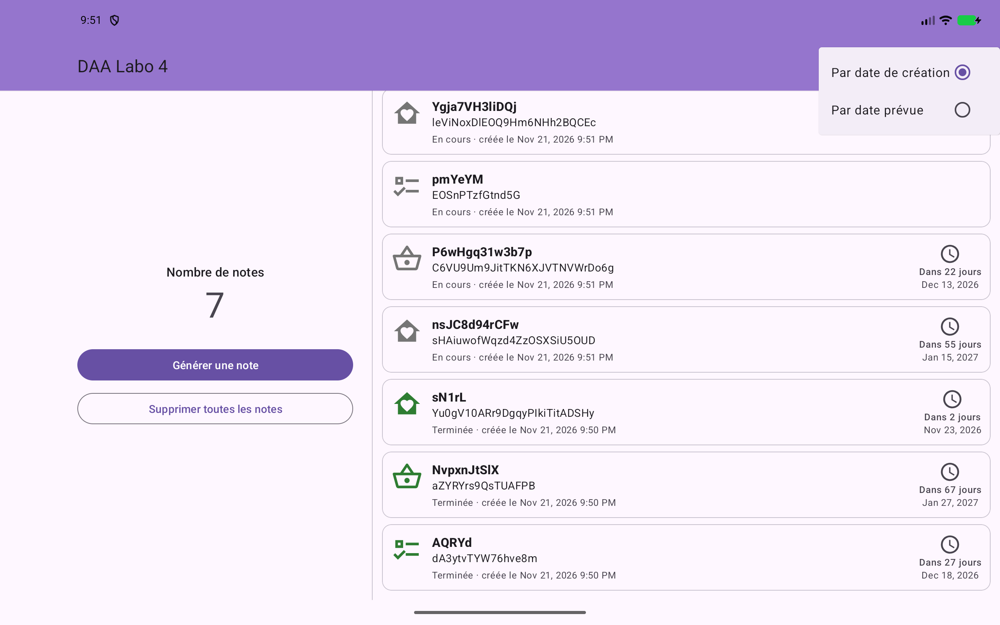

# DAA – Laboratoire 4

## Architecture MVVM, base de données Room et RecyclerView

| |                                           |
| --- |-------------------------------------------|
| **Auteurs** | François de Courville, Jonatan Perret     |
| **Groupe** | B_2                                       |
| **Classe** | DAA                                       |
| **Date** | 22.11.2026                                |
| **Cours** | DAA – Développement d'Application Android |

## Introduction

Ce laboratoire a pour but de réaliser une application qui affiche une liste de notes stockées dans une base de données Room, en suivant une architecture MVVM :

- le **modèle** comprend les entités fournies (`Note`, `Schedule`, `NoteAndSchedule`), la base de données Room et les repositories ;
- le **ViewModel** (`NotesViewModel`) expose les données sous forme de `LiveData` et les actions possibles ;
- la **vue** est composée de l'activité (`MainActivity`), de deux fragments et de la `RecyclerView`.

L'interface s'adapte à l'appareil : sur une tablette en paysage, un second fragment affiche le nombre de notes et deux boutons de contrôle.

Nous décrivons d'abord notre implémentation et nos choix, puis nous répondons aux questions de la donnée.
Les tests effectués et leurs résultats sont regroupés à la fin du rapport.

## Mise en place

Nous sommes partis du projet template de Cyberlearn, en gardant le package `ch.heigvd.iict.daa.template`, qui est aussi celui des entités fournies.
Les fichiers fournis ont été intégrés au projet :

| Fichier | Emplacement |
| --- | --- |
| `Note.kt`, `Schedule.kt`, `NoteAndSchedule.kt`, `State.kt`, `Type.kt` | `app/src/main/java/ch/heigvd/iict/daa/template/models/` |
| Icônes (`note.xml`, `todo.xml`, `shopping.xml`, `work.xml`, `family.xml`, `clock.xml`, `sort.xml`) | `app/src/main/res/drawable/` |

Les entités fournies importent `androidx.room3` : elles utilisent **Room 3**, la nouvelle version de Room, et pas Room 2 (`androidx.room`).
Nous avons donc utilisé Room 3.0.3, la dernière version stable. Elle a quelques différences avec Room 2 :

- le code de Room n'est généré qu'avec **KSP** ;
- les annotations `@TypeConverter(s)` s'appellent maintenant `@ColumnTypeConverter(s)` ;
- les `LiveData` ne sont plus supportées par défaut comme type de retour des DAO. Il faut ajouter la librairie `room3-livedata` et l'activer sur la base avec `@DaoReturnTypeConverters(LiveDataDaoReturnTypeConverter::class)` ;
- les méthodes du `Callback` de la base reçoivent une `SQLiteConnection` et sont `suspend`.

Le plugin KSP est ajouté dans le fichier Gradle du projet, et les dépendances dans celui du module `app`.
Les versions sont déclarées dans `gradle/libs.versions.toml`.
Le template utilise AGP 9, qui intègre Kotlin, il n'y a donc pas de plugin Kotlin à ajouter.

```kotlin
// build.gradle.kts (projet)
plugins {
    alias(libs.plugins.android.application) apply false
    alias(libs.plugins.ksp) apply false            // ksp = "2.3.14"
}

// app/build.gradle.kts
dependencies {
    implementation(libs.androidx.fragment.ktx)                 // 1.9.1
    implementation(libs.androidx.recyclerview)                 // 1.4.0
    implementation(libs.androidx.lifecycle.viewmodel.ktx)      // 2.11.1
    implementation(libs.androidx.lifecycle.livedata.ktx)       // 2.11.1
    implementation(libs.androidx.room.runtime)                 // room3-runtime 3.0.3
    implementation(libs.androidx.room.livedata)                // room3-livedata 3.0.3
    ksp(libs.androidx.room.compiler)                           // room3-compiler 3.0.3
    implementation(libs.androidx.datastore.preferences)        // 1.2.1 (question 6.1)
}
```

Nous utilisons DataStore 1.2.1 et pas 1.3.0, car la version 1.3.0 demande un `minSdk` de 24 et le template a un `minSdk` de 23.
Nous avons aussi activé le *View Binding* (`viewBinding = true`) pour accéder aux vues sans `findViewById`.

Le test `ExampleInstrumentedTest` du template échouait, car il attendait le package `ch.heigvd.iict.daa.daabasictemplate`. Nous avons corrigé la valeur attendue.

## L'activité et les fragments

### Implémentation et choix

Le changement d'interface entre smartphone et tablette se fait uniquement avec les **qualificateurs de ressources**, il n'y a aucun test sur le type d'appareil dans le code.

| Ressource | Contenu |
| --- | --- |
| `layout/activity_main.xml` | Un `FragmentContainerView` avec `NotesListFragment` (smartphone, tablette en portrait). |
| `layout-sw600dp-land/activity_main.xml` | `ControlsFragment` (1/3 de la largeur) et `NotesListFragment` (2/3). |
| `menu/main_menu.xml` | Sous-menu « Trier » (par date de création, par date prévue), « Générer une note » et « Supprimer toutes les notes ». |
| `menu-sw600dp-land/main_menu.xml` | Seulement le sous-menu « Trier », les deux autres actions sont des boutons du `ControlsFragment`. |

Comme demandé, la variante tablette combine une contrainte de **taille** (`sw600dp`, la plus petite largeur fait au moins 600 dp) et d'**orientation** (`land`).
Une tablette en portrait affiche donc la même interface qu'un smartphone, car la largeur ne suffit pas pour deux panneaux.

Le sous-menu de tri est un groupe à sélection unique (`checkableBehavior="single"`), l'option active est donc cochée.
L'activité observe l'ordre de tri et appelle `invalidateOptionsMenu()`, puis `onPrepareOptionsMenu()` coche l'option qui correspond.

L'activité et les deux fragments utilisent **la même instance** du ViewModel.
L'activité l'obtient avec `by viewModels { NotesViewModel.Factory }` et les fragments avec `by activityViewModels { NotesViewModel.Factory }`.
Les fragments observent les `LiveData` avec `viewLifecycleOwner`, les observateurs sont donc retirés quand la vue du fragment est détruite.

Le `ControlsFragment` affiche le nombre de notes (`countNotes`) et ses deux boutons appellent `generateANote()` et `deleteAllNote()`.

{ width=22% }
{ width=70% }

## La base de données Room

### Implémentation et choix

`CalendarConverter` convertit les `Calendar` en timestamp (`Long`, en millisecondes), car SQLite ne connaît pas ce type.
Les énumérations `State` et `Type` sont gérées directement par Room, qui les stocke avec leur nom.

Le DAO retourne des `LiveData` pour les lectures. Room les met à jour automatiquement quand les tables changent.
Les écritures sont des fonctions `suspend`, elles ne s'exécutent donc pas sur le thread UI.

```kotlin
@Transaction
suspend fun insertNoteWithSchedule(note: Note, schedule: Schedule?) {
    val noteId = insertNote(note)
    if (schedule != null) {
        schedule.ownerId = noteId          // lien One-to-One : l'id généré de la note
        insertSchedule(schedule)
    }
}

@Transaction
@Query("SELECT * FROM Note")
fun getAllNotes(): LiveData<List<NoteAndSchedule>>

@Query("SELECT COUNT(*) FROM Note")
fun getNotesCount(): LiveData<Int>

@Transaction
suspend fun deleteAll() { deleteAllSchedules(); deleteAllNotes() }
```

Les `Schedule` générés ont un `ownerId` à `-1`. Il faut donc d'abord insérer la note, puis donner son id à l'échéance.
Nous faisons les deux insertions dans une **transaction**, pour ne jamais avoir une note sans l'échéance prévue.

L'entité `Schedule` n'a pas de clé étrangère, donc pas de suppression en cascade.
`deleteAll()` supprime d'abord les échéances, puis les notes, dans une transaction. Il ne reste ainsi pas d'échéances orphelines.

`getAllNotes()` est aussi annotée `@Transaction`, car Room fait en fait deux requêtes (sur `Note` puis sur `Schedule`) pour remplir la relation.

`NotesDatabase` est un singleton.
Un `Callback` remplit la base avec 10 notes aléatoires lors de sa **création** (`populate()`).
`onCreate()` est appelé pendant l'ouverture de la base, on ne peut donc pas utiliser le DAO directement dedans. Nous lançons l'insertion dans une coroutine séparée.
Les notes générées par `Note.generateRandomNote()` ont toutes la date du moment. Pour que le tri par date de création soit visible avec les données de test, nous reculons leur date de création au hasard dans les 7 derniers jours.

### Repository et Application

`NotesRepository` est le seul point d'accès aux notes. Il expose `allNotes` et `countNotes`, et lance les écritures.
Les écritures sont lancées dans un `CoroutineScope(SupervisorJob())` lié à l'**application** et pas à un écran : une écriture commencée n'est pas annulée si l'écran est détruit entre-temps.

La classe `NotesApp` surcharge `Application` (déclarée avec `android:name` dans le manifeste).
Elle crée les deux repositories avec `by lazy`, ils sont donc créés une seule fois pour toute l'application.

## Le ViewModel

### Implémentation et choix

`NotesViewModel` met à disposition les valeurs et méthodes demandées, ainsi que l'ordre de tri :

```kotlin
class NotesViewModel(
    private val notesRepository: NotesRepository,
    private val sortPreferencesRepository: SortPreferencesRepository
) : ViewModel() {
    val allNotes: LiveData<List<NoteAndSchedule>> = notesRepository.allNotes
    val countNotes: LiveData<Int> = notesRepository.countNotes
    val sortOrder: LiveData<SortOrder> =
        sortPreferencesRepository.sortOrder.asLiveData()

    fun generateANote() { notesRepository.generateANote() }
    fun deleteAllNote() { notesRepository.deleteAllNotes() }
    fun sortBy(order: SortOrder) { sortPreferencesRepository.setSortOrder(order) }

    companion object {
        val Factory: ViewModelProvider.Factory = viewModelFactory {
            initializer {
                val app = this[APPLICATION_KEY] as NotesApp
                NotesViewModel(app.notesRepository, app.sortPreferencesRepository)
            }
        }
    }
}
```

Le ViewModel n'a **aucune référence** vers une activité, un fragment, une vue, l'`Application` ou un `Context`.
Il reçoit les repositories dans son constructeur.
L'`Application` est seulement utilisée dans la *factory* pour récupérer les repositories, elle n'est pas gardée par le ViewModel.

L'ordre de tri est dans le ViewModel, et pas dans le fragment, pour être partagé entre le menu de l'activité et la liste.
Il survit ainsi aux rotations, et grâce à DataStore, aussi à la fermeture de l'application (voir la question 6.1).

## La RecyclerView

### Implémentation et choix

`NotesAdapter` hérite de `ListAdapter`, qui est une sous-classe de `RecyclerView.Adapter`.
`ListAdapter` calcule les différences entre l'ancienne et la nouvelle liste avec `DiffUtil`, sur un thread en arrière-plan.
Seuls les éléments modifiés sont redessinés, avec une animation, au lieu de toute la liste avec `notifyDataSetChanged()`.
Deux éléments sont la même note s'ils ont le même `noteId`.

`getItemViewType()` choisit entre deux layouts : `list_item_note.xml` pour les notes simples et `list_item_note_schedule.xml` pour les notes avec une échéance.
Chaque layout a son `ViewHolder`. Le code commun aux deux (icône, titre, texte, état, date de création) est dans la classe de base `NoteViewHolder`.

Tous les champs sont visibles :

- le **type** est représenté par l'icône fournie qui correspond ;
- l'**état** est indiqué par la couleur de l'icône (vert : terminée, gris : en cours) et par un texte ;
- le **titre**, le **texte** et la **date de création** sont affichés ;
- pour une échéance, la **date prévue** et le délai (« Dans 12 jours », « Aujourd'hui »). Une note en cours dont la date est passée affiche « En retard », en rouge. Une note terminée n'est pas en retard, elle affiche « Il y a *n* jours ».

Les dates sont formatées avec `DateFormat`, selon la langue du téléphone.
Les couleurs ont une variante pour le thème sombre (`values-night/colors.xml`).

Comme demandé, c'est l'adapter qui trie les notes.
Il garde la dernière liste reçue de la base et l'ordre de tri choisi, et affiche la liste triée quand l'un des deux change :

```kotlin
fun sortNotes(notes: List<NoteAndSchedule>, sortOrder: SortOrder) = when (sortOrder) {
    SortOrder.NONE -> notes
    SortOrder.BY_CREATION_DATE -> notes.sortedByDescending { it.note.creationDate }
    SortOrder.BY_SCHEDULE_DATE ->
        notes.sortedWith(compareBy(nullsLast()) { it.schedule?.date })
}
```

Le tri par date de création met les notes les plus récentes en premier.
Le tri par date prévue met l'échéance la plus proche en premier (donc les retards), et les notes sans échéance à la fin.

Au démarrage, l'ordre de tri est lu de façon asynchrone. Tant qu'il n'est pas connu, l'adapter n'affiche rien. Sinon, la liste s'afficherait un court instant non triée, puis serait réordonnée.

Nous avons ajouté deux détails dans `NotesListFragment` :

- après un changement de tri, la liste revient en haut ;
- quand une note est ajoutée en haut de la liste (tri par date de création) et que l'utilisateur est déjà en haut, la liste défile pour la montrer. Sans cela, `LinearLayoutManager` garde l'ancien premier élément en haut, et la nouvelle note est ajoutée au-dessus, hors de l'écran.

Quand la liste est vide, le texte « Aucune note » est affiché.

{ width=22% }
{ width=22% }
{ width=22% }

## Questions

> 6.1 Quelle est la meilleure approche pour sauver, même après la fermeture de l'app, le choix de l'option de tri de la liste des notes ? Vous justifierez votre réponse et l'illustrez en présentant le code mettant en œuvre votre approche.

Le choix de tri est une **préférence de l'utilisateur** : une seule valeur simple, qui doit survivre à la fermeture de l'application.
Les différentes solutions ne conviennent pas toutes :

- **ViewModel** : la valeur survit à une rotation, mais elle est perdue quand le processus est détruit.
- **`onSaveInstanceState` / `SavedStateHandle`** : la valeur survit quand le système tue le processus, mais **pas** quand l'utilisateur ferme l'application (retour arrière, suppression dans les applications récentes).
- **Room** : la valeur est persistante, mais une table, une entité et un DAO pour une seule valeur, c'est trop.
- **SharedPreferences** : persistant et simple, mais l'API est synchrone. La première lecture bloque le thread qui la fait (risque d'ANR sur le thread UI), `apply()` peut bloquer le thread UI dans `onPause()` en attendant l'écriture, et les erreurs d'écriture ne sont pas signalées.
- **Jetpack DataStore (Preferences)** : c'est le remplaçant des SharedPreferences recommandé par Google. Les lectures sont un `Flow` qu'on peut observer, les écritures sont des fonctions `suspend`. Il n'y a pas d'accès au fichier sur le thread UI et les erreurs sont remontées.

**DataStore Preferences est donc la meilleure approche.** Nous l'avons implémentée dans l'application.
Elle s'intègre bien dans notre architecture : le choix de tri passe par un repository, comme les notes, et le ViewModel le transforme en `LiveData`.

```kotlin
// NotesApp.kt : une seule instance de DataStore par processus
private val Context.settingsDataStore: DataStore<Preferences>
        by preferencesDataStore(name = "settings")

class NotesApp : Application() {
    private val applicationScope = CoroutineScope(SupervisorJob())
    val sortPreferencesRepository by lazy {
        SortPreferencesRepository(settingsDataStore, applicationScope)
    }
}

// SortPreferencesRepository.kt
class SortPreferencesRepository(
    private val dataStore: DataStore<Preferences>,
    private val applicationScope: CoroutineScope
) {
    val sortOrder: Flow<SortOrder> = dataStore.data
        .catch { e -> if (e is IOException) emit(emptyPreferences()) else throw e }
        .map { prefs ->
            val storedName = prefs[SORT_ORDER_KEY]
            SortOrder.entries.firstOrNull { it.name == storedName } ?: SortOrder.NONE
        }
        .distinctUntilChanged()

    fun setSortOrder(sortOrder: SortOrder) {
        applicationScope.launch {
            dataStore.edit { prefs -> prefs[SORT_ORDER_KEY] = sortOrder.name }
        }
    }

    companion object {
        private val SORT_ORDER_KEY = stringPreferencesKey("sort_order")
    }
}

// NotesViewModel.kt
val sortOrder: LiveData<SortOrder> = sortPreferencesRepository.sortOrder.asLiveData()
fun sortBy(order: SortOrder) { sortPreferencesRepository.setSortOrder(order) }

// NotesListFragment.kt : l'adapter trie la liste à chaque changement
viewModel.sortOrder.observe(viewLifecycleOwner) { sortOrder ->
    adapter.setSortOrder(sortOrder) { recyclerView.scrollToPosition(0) }
}
```

Nous stockons le **nom** de l'ordre de tri (`sortOrder.name`) et pas sa position dans l'énumération.
Si l'ordre des valeurs de l'énumération change plus tard, les valeurs déjà enregistrées gardent leur sens. Une valeur inconnue donne `NONE`.

Nous avons vérifié que le tri choisi est conservé après un arrêt forcé de l'application.

> 6.2 L'accès à la liste des notes issues de la base de données Room se fait avec une LiveData. Est-ce que cette solution présente des limites ? Si oui, quelles sont-elles et quelles seraient les approches mieux adaptées ?

Oui, il y a plusieurs limites :

- **Dépendance à Android et au thread principal.** Une `LiveData` ne peut être observée que sur le thread principal, et elle ne peut pas être utilisée dans du code Kotlin sans Android (couches domaine, Kotlin Multiplatform). Le DAO et le repository dépendent ainsi d'une classe faite pour l'interface, et ils sont plus difficiles à tester sans Android.
- **Peu d'opérateurs.** Il n'y a que `map`, `switchMap` et `distinctUntilChanged`. Pour combiner deux sources (par exemple les notes et l'ordre de tri), il faut écrire un `MediatorLiveData`. Il n'y a pas de `combine`, pas de `debounce`, et on ne peut pas choisir le thread des transformations : un `map` coûteux, comme un tri, s'exécute sur le thread UI.
- **Toute la liste est rechargée.** Room surveille les tables entières : toute modification de `Note` **ou** de `Schedule` relance la requête et recharge **toutes** les notes en mémoire. Avec quelques dizaines de notes, ce n'est pas un problème, mais avec des milliers, la mémoire, le temps de requête et le calcul des différences deviennent un problème.
- **Un état et pas des événements.** Une `LiveData` garde la dernière valeur et la renvoie à chaque nouvel observateur, par exemple après une rotation. C'est bien pour un état comme la liste, mais pas pour un événement ponctuel (message d'erreur, navigation), pour lequel il faut des contournements (*SingleLiveEvent*).
- **Pas de gestion des erreurs.** Une exception pendant la requête ne peut pas être transmise à l'observateur.

Les approches mieux adaptées sont :

- **Kotlin Flow**, que Room supporte directement (`fun getAllNotes(): Flow<List<NoteAndSchedule>>`). Les flows ne dépendent pas d'Android, ont beaucoup d'opérateurs (`combine`, `map`, `flowOn`, `catch`, `debounce`...) et permettent de choisir le thread des traitements. Le ViewModel expose un `StateFlow` avec `stateIn()`, et la vue le collecte en respectant le cycle de vie (`repeatOnLifecycle`, ou `collectAsStateWithLifecycle` avec Compose). Par exemple, on peut combiner les notes et le tri hors du thread UI :

```kotlin
val notes: StateFlow<List<NoteAndSchedule>> =
    combine(repository.allNotes, sortPreferences.sortOrder) { notes, order ->
        sortNotes(notes, order)
    }
    .flowOn(Dispatchers.Default)
    .stateIn(viewModelScope, SharingStarted.WhileSubscribed(5_000), emptyList())
```

- On pourrait aussi trier directement en SQL (`ORDER BY`), en changeant de requête selon l'ordre choisi avec `flatMapLatest`.
- **Paging 3** pour les grandes listes : Room génère une `PagingSource` (`fun pagedNotes(): PagingSource<Int, NoteAndSchedule>`) et seules les pages affichées sont chargées, avec un `PagingDataAdapter` pour la `RecyclerView`.
- **`SharedFlow` ou `Channel`** pour les événements ponctuels.

D'ailleurs, dans Room 3, le support des `LiveData` est devenu une librairie optionnelle construite sur les flows.

> 6.3 Les notes affichées dans la RecyclerView ne sont pas sélectionnables ni cliquables. Comment procéderiez-vous si vous souhaitiez proposer une interface permettant de sélectionner une note pour l'éditer ?

Nous procéderions en quatre étapes.

**1. Rendre les éléments cliquables.**
L'adapter reçoit une fonction à appeler lors d'un clic, il ne décide pas lui-même de ce qui se passe.
Chaque `ViewHolder` ajoute le listener **une seule fois**, dans son `init`, et pas dans `onBindViewHolder()`, qui est appelé à chaque recyclage.
La position est lue au moment du clic, car elle peut avoir changé depuis l'affichage :

```kotlin
class NotesAdapter(
    private val onNoteClicked: (NoteAndSchedule) -> Unit
) : ListAdapter<NoteAndSchedule, NotesAdapter.NoteViewHolder>(NotesDiffCallback) {

    abstract inner class NoteViewHolder(itemView: View) :
        RecyclerView.ViewHolder(itemView) {
        init {
            itemView.setOnClickListener {
                val position = bindingAdapterPosition
                if (position != RecyclerView.NO_POSITION) {
                    onNoteClicked(getItem(position))
                }
            }
        }
    }
}
```

Dans le layout de l'élément, on ajoute `android:foreground="?attr/selectableItemBackground"` (ou `android:clickable="true"` sur la `MaterialCardView`), pour avoir un effet visuel lors du clic.

**2. Garder la note sélectionnée dans le ViewModel.**
Le fragment transmet le clic au ViewModel. Celui-ci garde l'id de la note sélectionnée dans un `SavedStateHandle`, pour qu'il survive à la mort du processus, et expose la note :

```kotlin
// NotesListFragment
val adapter = NotesAdapter { item -> viewModel.selectNote(item.note.noteId!!) }

// NotesViewModel
private val selectedNoteId = savedStateHandle.getLiveData<Long?>("selectedNoteId")
val selectedNote: LiveData<NoteAndSchedule?> = selectedNoteId.switchMap { id ->
    if (id == null) MutableLiveData(null) else repository.getNote(id)
}
fun selectNote(id: Long) { selectedNoteId.value = id }

// NotesDao
@Transaction @Query("SELECT * FROM Note WHERE noteId = :id")
fun getNote(id: Long): LiveData<NoteAndSchedule?>
@Update suspend fun updateNote(note: Note)
@Upsert suspend fun upsertSchedule(schedule: Schedule)
```

**3. Afficher l'écran d'édition selon l'appareil.**
Sur smartphone, un `NoteEditFragment` remplace la liste, avec le *Navigation component* ou une transaction de fragment ajoutée à la *back stack*, pour que le bouton retour ramène à la liste.
Sur tablette en paysage, l'éditeur s'affiche à côté de la liste (*master-detail*), avec un `SlidingPaneLayout` ou un troisième conteneur dans `layout-sw600dp-land`.
Le fragment d'édition observe `selectedNote` et affiche des champs modifiables (titre, texte, type, état, et date prévue avec un `MaterialDatePicker`).
Lors de l'enregistrement, il appelle une méthode du ViewModel qui met à jour la base. La liste se met à jour toute seule grâce aux `LiveData` de Room.

**4. Mettre en évidence la note sélectionnée.**
Sur tablette, la note en cours d'édition doit être visible dans la liste.
L'adapter reçoit l'id sélectionné, et le `ViewHolder` utilise `itemView.isActivated = (note.noteId == selectedId)` avec un *state list drawable*, ou `isChecked` sur la `MaterialCardView`.
Seuls l'ancien et le nouvel élément sélectionnés sont redessinés, avec `notifyItemChanged()`.

Pour sélectionner plusieurs notes (par exemple pour les supprimer), la librairie `androidx.recyclerview:recyclerview-selection` fournit un `SelectionTracker`.
Il gère la sélection par appui long et la conserve après une rotation. Il se configure avec un `ItemKeyProvider` basé sur `noteId` et un `ItemDetailsLookup`, et s'utilise avec un *Contextual Action Mode* dans la barre d'action.

## Tests effectués et résultats

Les tests ont été effectués le 21.11.2026 sur un émulateur Pixel 10a (Android API 37), configuré en anglais américain.
La tablette a été simulée sur le même émulateur avec `adb shell wm size 1600x2560` et `adb shell wm density 320`, ce qui donne une plus petite largeur de 800 dp.
Tous les résultats obtenus correspondent aux résultats attendus.

| Manipulation | Résultat obtenu |
| --- | --- |
| Lancer l'application pour la première fois | 10 notes de test sont affichées, avec et sans échéance. Une note en cours avec une date passée affiche « En retard » en rouge. |
| Choisir « Trier » puis « Par date prévue » | La note en retard est en premier, puis les échéances par date croissante, puis les notes sans échéance. L'option est cochée dans le menu. |
| Forcer l'arrêt de l'application puis la relancer | La liste est toujours triée par date prévue, l'écran est identique à celui d'avant l'arrêt. |
| Choisir « Supprimer toutes les notes » | La liste est vide et le texte « Aucune note » s'affiche. |
| Choisir trois fois « Générer une note » | Trois notes apparaissent. |
| Choisir « Trier » puis « Par date de création » | Les notes les plus récentes sont en premier. |
| Passer en tablette, en paysage | Le panneau de contrôle s'affiche à gauche de la liste, le menu ne contient plus que « Trier ». |
| Appuyer deux fois sur « Générer une note » dans le panneau | Le compteur passe de 7 à 9 et la dernière note créée est visible en haut de la liste. |
| Passer en tablette, en portrait | Seule la liste est affichée, sans panneau de contrôle, et le bouton de menu « ⋮ » est à nouveau présent. |
| Tourner l'écran | Les notes, le compteur et le tri sont conservés, il n'y a pas d'erreur dans les logs. |
| Activer le thème sombre | La liste est lisible et les couleurs de l'état sont adaptées. |

Nous avons aussi écrit des tests automatisés :

| Test | Vérification | Résultat |
| --- | --- | --- |
| `NotesAdapterSortTest` (unitaire) | Tri sans ordre, par date de création et par date prévue (sans échéance à la fin), la liste d'origine n'est pas modifiée, calcul du nombre de jours jusqu'à une date. | 5/5 réussis |
| `NotesDaoTest` (instrumenté, base en mémoire) | Insertion avec et sans échéance, `ownerId` égal à l'id de la note, date conservée à la milliseconde, compteur, `deleteAll()` vide les deux tables. | 2/2 réussis |
| `ExampleInstrumentedTest` (template) | Nom du package de l'application. | 1/1 réussi |

L'analyse *lint* ne signale pas de problème dans notre code. Elle signalait que le compteur n'était pas formaté selon la langue, nous utilisons maintenant `NumberFormat`.

{ width=70% }

## Utilisation d'outils d'IA

Nous avons utilisé Claude Code (Anthropic) pendant ce laboratoire. Voici ce qui vient de l'outil et ce qui vient de nous.

- **Manipulations** : l'IA a été utilisée pour renommer le projet (package name), ainsi qu'en tant que correcteur d'orthographe pour ce rapport.
- **Tests** : l'IA a exécuté les manipulations et les tests sur l'émulateur et a mis en forme les résultats.
- **Rapport et commentaires** : l'IA a mis en forme le rapport, rédigé les descriptions d'implémentation à partir du code et ajouté les commentaires de documentation dans les fichiers Kotlin.

Nous avons relu le code et les textes produits par l'IA avant le rendu.

## Conclusion

Ce laboratoire nous a permis de mettre en place une architecture MVVM complète : une base Room, un repository, un ViewModel partagé entre l'activité et deux fragments, et une `RecyclerView` avec deux layouts.
Grâce aux `LiveData`, l'interface se met à jour toute seule quand la base change, et les rotations ne demandent pas de code particulier.
Les qualificateurs de ressources permettent d'avoir une interface différente sur tablette sans aucun test dans le code.
Le point qui nous a demandé le plus d'attention est Room 3 : il est plus récent que la plupart des exemples, et il faut activer les `LiveData` et utiliser les nouvelles annotations.

## Bibliographie

- Donnée du laboratoire 4 et supports du cours DAA, HEIG-VD.
- Documentation Android, *Save data in a local database using Room* : <https://developer.android.com/training/data-storage/room>
- Documentation Android, *Room 3 release notes* : <https://developer.android.com/jetpack/androidx/releases/room3>
- Documentation Android, *DataStore* : <https://developer.android.com/topic/libraries/architecture/datastore>
- Documentation Android, *Kotlin flows on Android* : <https://developer.android.com/kotlin/flow>
- Documentation Android, *Paging library overview* : <https://developer.android.com/topic/libraries/architecture/paging/v3-overview>
- Documentation Android, *Create dynamic lists with RecyclerView* : <https://developer.android.com/develop/ui/views/layout/recyclerview>
- Documentation Android, *Support different screen sizes* : <https://developer.android.com/develop/ui/views/layout/responsive-adaptive-design-with-views>
